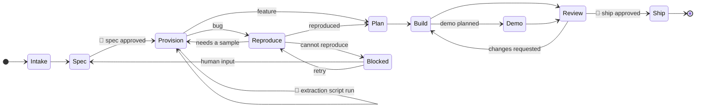

<div align="center">


# Rouage

**The open-source state-machine core for building your own software factory.**

<sub><i>rouage</i> /ʁu.aʒ/ (French, noun): a gear in a mechanism; one of the parts that make the whole thing turn.</sub>

<br>

[](#roadmap)
[](https://github.com/tonytangdev/rouage/actions/workflows/ci.yml)
[](LICENSE)
[](https://effect.website)
[](https://stately.ai/docs)
<br>
[](https://github.com/sponsors/tonytangdev)
[](https://buymeacoffee.com/tonytangdev)

▶️ [Watch the 1-minute intro](https://www.youtube.com/shorts/LPl8fMZJOy8)

[Why](#why-rouage) · [How it works](#how-it-works) · [Principles](#principles) · [Plugins](#plugins) · [API](#a-glimpse-of-the-api) · [Roadmap](#roadmap)

</div>

> [!WARNING]
> **Rouage is pre-alpha.** The design is being worked out in the open and nothing runs yet. This README describes what Rouage is being built to do. APIs, names and packages will change.

## Why Rouage

AI agents can write code. Turning that into a **software factory** (a system that reliably carries work from an issue to shipped software) takes everything around the code: a reproduced bug before anyone touches it, a safe environment to work in, evidence that the change works, and humans in the loop where it matters.

Most teams glue this together with prompts and shell scripts, and the lifecycle ends up living nowhere in particular.

Rouage makes the lifecycle the product. It models the software engineering lifecycle as **explicit state machines**, and you plug your own tools into it: Claude Code, Docker, agent skills, plain scripts, your database. Rouage is the core; the factory is yours.

## How it works

Every **work item** (a bug or a feature, usually from an issue) travels through a **lifecycle** of stages. Here is the default one; 🚦 marks a **gate**, where the work item waits for its **gatekeeper**'s decision: a human by default, or a plugin, such as an agent following rules you write, that decides for you or asks you.



A stage that fails, or a loop that goes around too many times, also makes the work item **blocked**, and a human can retry the stage it came from. A human can cancel a work item at any point.

| Stage         | What happens                                                                                                                    |
| ------------- | ------------------------------------------------------------------------------------------------------------------------------- |
| **Intake**    | A work item enters the factory and is classified as a **bug** or a **feature**.                                                 |
| **Spec**      | The expected behaviour is written down. Its gatekeeper approves it before any work starts.                                      |
| **Provision** | The **sandbox** is prepared: images built, services started, data seeded. Everything after this runs in the same sandbox.       |
| **Reproduce** | Bugs only. A **reproduction** is captured: evidence that the bug exists, before anything changes. No reproduction, no fix.      |
| **Plan**      | The change is planned, including whether a **demo** is worth it (a large feature or a bug fix, say). A human can override that. |
| **Build**     | The change is made, with tests.                                                                                                 |
| **Demo**      | Optional. Evidence that the change works, captured in the same sandbox as the reproduction.                                     |
| **Review**    | The change, its tests and its evidence are reviewed. Review can send it back to Build.                                          |
| **Ship**      | Its gatekeeper approves, and the change is delivered.                                                                           |

The default lifecycle is a starting point, not a rule: add stages, remove them, move gates, or replace the whole machine.

## Principles

- **Evidence before and after.** A bug is reproduced before it is fixed, and a significant change is demonstrated after it is built. Reviewers see proof, not claims.
- **Autonomous where you want it, gated where you need it.** Any transition can become a gate, and each gate's gatekeeper is a human, an agent that may ask a human, or an agent alone.
- **One sandbox, end to end.** The reproduction, the build and the demo run in the same provisioned environment, so before and after are comparable.
- **Agents see your schema, not your customers, unless you say so.** See [Real data, safely](#real-data-safely).
- **Every part is replaceable.** The lifecycle and every plugin sit behind a contract. Rouage ships defaults; you swap what you like.

### Real data, safely

Sometimes the only way to be sure a fix works is to reproduce the bug against the exact data that triggers it. Rouage supports that without handing your production data to an agent by default.

- **Schema access (default).** The agent reads your database schema, never its rows. To get a **sample**, it writes an extraction script with **sanitization** built in, governed by an allowlist of fields that may pass. You review the script and run it yourself; only the sanitized output reaches the sandbox.
- **Data access (opt-in).** You give a standing, revocable **grant** for one data source, and the agent may query it directly through read-only credentials. Rouage refuses to start a data source whose role can write, and logs every use of a grant.

Credentials always stay with you. Samples are destroyed with the sandbox and never committed. The full reasoning is in [ADR 0001](docs/adr/0001-agents-read-real-data-only-with-a-grant.md).

## Plugins

Everything outside the lifecycle is a **plugin**. Each plugin has a **kind**, and each kind has its own contract.

| Kind            | Role                                    | Planned first-party plugin |
| --------------- | --------------------------------------- | -------------------------- |
| **Agent**       | Does work using AI                      | `@rouage/claude-code`      |
| **Script**      | Does work deterministically, without AI | `@rouage/scripts`          |
| **Sandbox**     | Isolates where a work item's work runs  | `@rouage/docker`           |
| **Skill**       | Instructions an agent loads             | `@rouage/skills`           |
| **Data source** | Gives access to your real data          | `@rouage/postgres`         |

Install only the plugins you need. Third-party plugins implement the same contracts as first-party ones.

## A glimpse of the API

> [!NOTE]
> This is the **intended** API, shown to make the design concrete. It does not exist yet and will change.

```ts
import { claudeCode } from "@rouage/claude-code";
import { docker } from "@rouage/docker";
import { postgres } from "@rouage/postgres";
import { scripts } from "@rouage/scripts";
import { skills } from "@rouage/skills";
import { createFactory, defaultLifecycle } from "rouage";

const factory = createFactory({
  lifecycle: defaultLifecycle,
  plugins: [
    claudeCode(),
    skills({ directory: "./skills" }),
    scripts({ directory: "./scripts" }),
    docker({ compose: "./docker-compose.yml" }),
    postgres({
      access: "schema",
      sanitize: {
        users: ["id", "plan", "created_at"],
        orders: ["id", "user_id", "status", "total"],
      },
    }),
  ],
});
```

## Built on Effect and XState

Rouage is a TypeScript project built on two libraries that each do one job well.

- **[XState](https://stately.ai/docs) models the lifecycle.** Each stage is a state and each move is an explicit transition, so the lifecycle is something you can read, visualise, test and change, not behaviour scattered across scripts. Where a work item is, and how it can move next, is always known.
- **[Effect](https://effect.website) runs everything the lifecycle touches.** Agents, sandboxes, scripts and databases are side effects that fail, time out and need cleaning up. Effect gives Rouage typed errors, retries, timeouts, structured concurrency, and resource safety, so a sandbox is torn down even when a run fails halfway.

## Roadmap

- [ ] Lifecycle core: the default lifecycle as a state machine, with gates
- [ ] Plugin contracts for every kind
- [ ] Docker sandbox
- [ ] Claude Code agent with skills
- [ ] Scripts
- [ ] Evidence: reproductions and demos attached to work items
- [ ] Data sources with schema access, sanitization and grants

Progress is tracked in [GitHub Issues](https://github.com/tonytangdev/rouage/issues).

## Design docs

- [`GLOSSARY.md`](GLOSSARY.md): the project's language. Every term in this README is defined there.
- [`docs/adr/`](docs/adr/): architecture decision records, the "why" behind decisions that are hard to reverse.

## Support

If Rouage is useful to you, or you want to see it grow, you can support its development:

<a href="https://github.com/sponsors/tonytangdev"></a>
<a href="https://buymeacoffee.com/tonytangdev"></a>

## License

[MIT](LICENSE)
